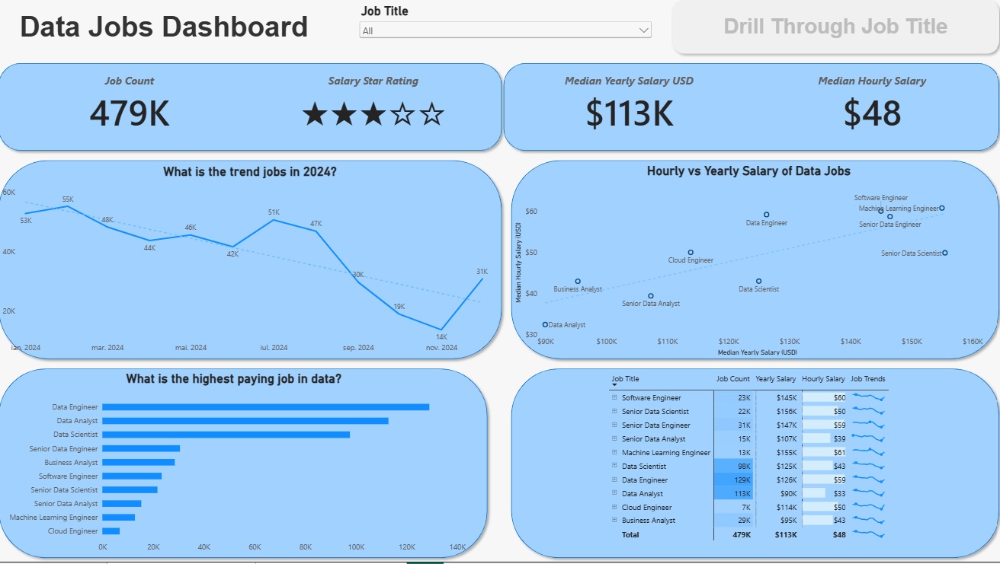
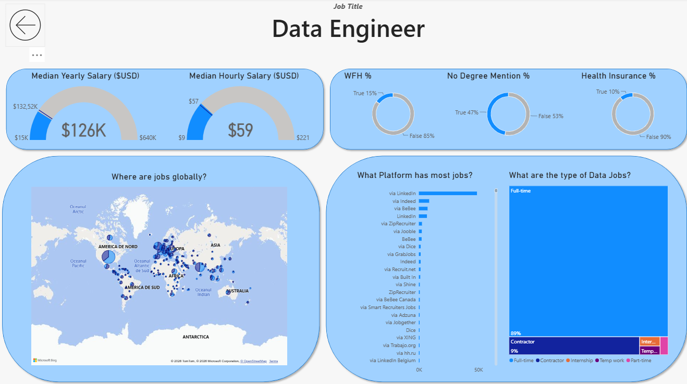

# Data Jobs Dashboard w/ Power BI

## Introduction

I built this dashboard to explore the 2024 data job market in one place: which roles are most in demand, what they pay and where they are located. The dataset contains 2024 data science job postings with title, salary and location. [job_postings_monthly.xlsx](job_postings_monthly.xlsx)

## What I used

- Power Query: handled blanks, fixed data types, added new columns
- Measures: Median Yearly Salary, Job Count
- Visuals: column, bar, line and area charts for job counts and trends over time, a map for job locations, cards for KPIs, a table for detailed data
- Slicer on job title
- Buttons and bookmarks for navigation
- Drill-through from the overview page to a detail page

## Pages

### Page 1: Overview
Shows total job count, median salary and the most common job titles. A slicer filters everything by job title.

### Page 2: Job title drill-through
Opens from the overview for one selected job title. Shows salary range, work-from-home share, top hiring platforms and a map of job locations.

## File
[`Data_Jobs_Dashboard.pbix`](Data_Jobs_Dashboard.pbix)